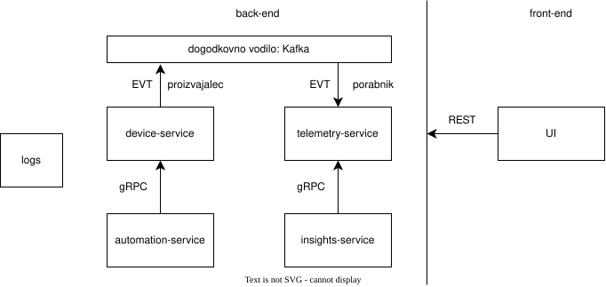

# Sistem za upravljanje energije v pametnem domu

### Skupina, člani:
Skupina *__(ime - todo)__* (4): Gašper Suhadolnik, Gašper Harej

### Opis projekta:
Namen projekta je uporabnikom pametnih domov omogočiti enostaven pregled nad porabo energije in upravljanjem pamethin naprav na energetsko učinkovit način. Cilj projekta je razvoj sistema, ki spremlja porabo energije, izvaja avtomatsko vklapljanje in izklapljanje naprav in podaja nasvete o možnostih zmanjšanja porabe energije. Celotna rešitev je zasnovana na cloud-native arhitekturi, kar omogoča horizontalno skaliranje, visoko razpoložljivost in neodvisno razvijanje posamezne funkcionalnosti.

### Ogrodje in razvojno okolje
Uporabljene tehnologije: Kubernetes, Docker, FastAPI, VSCode, helm, CI/CD, Github Actions, PostgreSQL, REST, Apache Kafka, graphQL, gRPC, Angular
<!-- a tut Spring Boot, IntellijIDEA? -->
<!-- todo: pregled -->

### Shema arhitekture

<!-- todo - potrebno izboljšati izgled, po potrebi dopolniti -->

### Seznam funkcionalnosti mikrostoritev
__device-service__:
* vklop, izklop posamezne naprave
* dodajanje nove naprave
* odstranitev naprave
* pregled stanja naprave (vklop, izklop, trenutna poraba energije)

__telemetry-service__:
* spremljanje porabe energije naprav
* shranjevanje podatkov o porabi energije naprav

__automation-service__:
* avtomatični vklop ali izklop naprav ob določenih časih glede na postavljena pravila
* dodajanje (tudi odstranitev, enable, disable) pravil za avtomatični vklop in izklop naprav

__insights-service__:
* analiza porabe energije
* generiranje nasvetov o možnosti zmanjšanja porabe energije

### Primeri uporabe
| #  | Ime     | Opis    | Udeležene mikrostoritve |
| -  | ------- | ------- | - |
| 1  | Dodajanje nove naprave | Uporabnik doda novo napravo v sistem spremljanja energije. | device-service |
| 2  | Upravljanje naprav | Uporabnik ročno vklopi ali izklopi napravo. Pri odločitvi si lahko pomaga s trenutnim stanjem naprave (vklopljena, izklopljena, povprečna poraba), ki je prikazano na uporabniškem vmesniku. | device-service |
| 3  | Nastavitev urnika vklopa in izklopa naprave | Uporabnik ustvari pravilo za avtomatični vklop ali izklop naprave.  | automation-service |
| 4  | Pregled porabe posamezne naprave v določenem obdobju | Uporabnik izbere napravo s seznama in ob tem se mu prikaže graf porabe te naprave v doloečnem obdobju (dan, teden, mesec). | telemetry-service |
| 5  | Predlogi za zmanjšanje porabe    | Uporabnik zahteva nasvet oz. priporočila za zmanjšanje porabe. Ob kliku na gumb, se zajamejo podatki iz telemetry-service in avtomatičnih pravil in v ustrezni obliki posredujejo llm-u, ki vrne predloge za zmanjšanje porabe ali prilagoditev določenega pravila. | insights-service, telemetry-service, automation-service |

<!-- todo - dodati se ksnga -->

